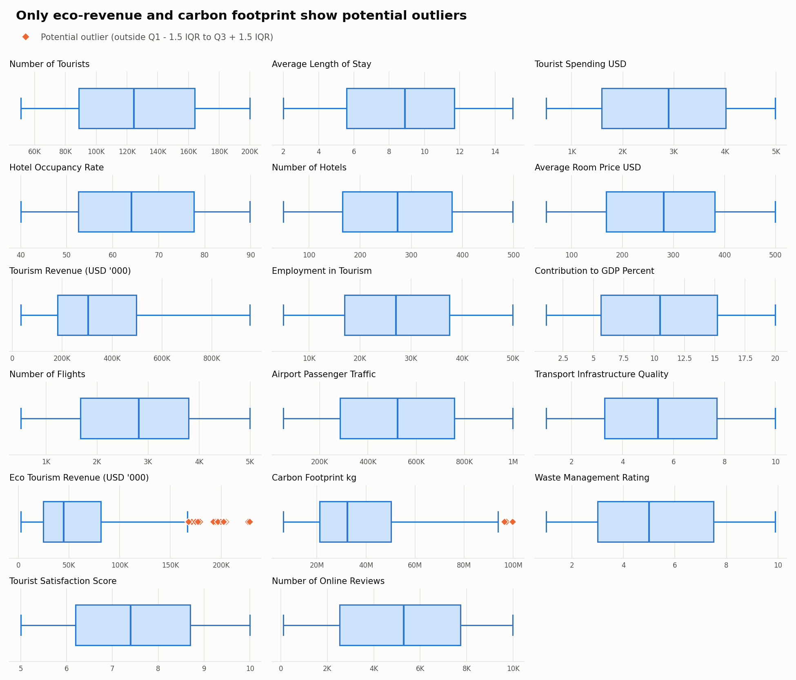
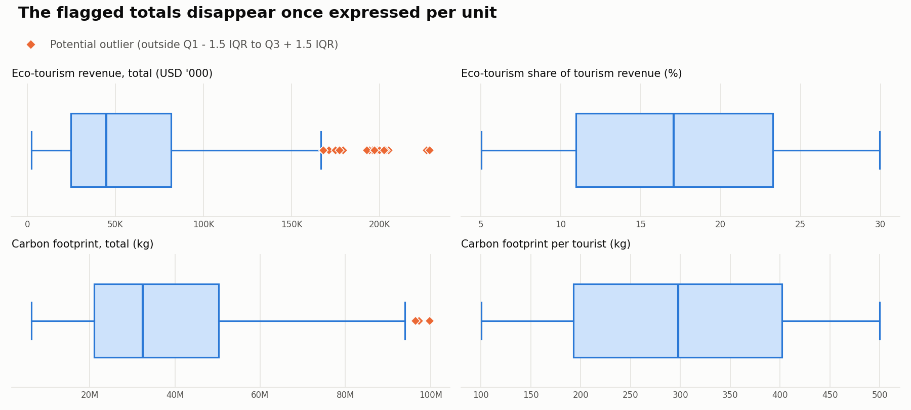
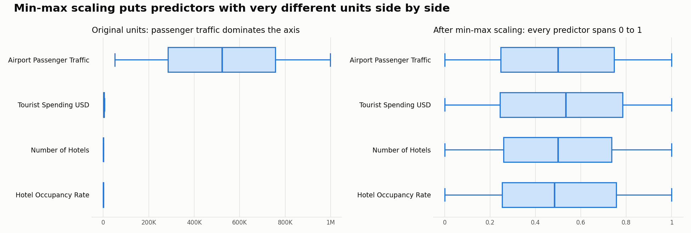

# Phase 3: Data Preprocessing and Preparation

A dataset can look clean and still need looking at. Ours arrived as 500 records and 23 columns, with no blanks and no repeated rows, and for a moment it seemed there was very little left to do. But what does a tidy file actually tell us? Only that nothing is visibly missing. Whether the values mean what their column names claim, whether they can be believed, and whether later phases can use them in the form they arrived, those questions were still open, and the five steps below are how we went about answering them.

The techniques and formulas follow DOM 304 Module 2 (Data Pre-Processing). The script `analysis/phase3_data_preprocessing.py` calculates the results, and the raw file itself was never altered.

## Step 1: Data quality assessment

We began with the obvious worries. Every cell across all 500 records was tested for blanks and for placeholders such as NA, null or a lone dash, and none appeared. There are no exact duplicates, no stray spaces and no labels differing only in case, each of the 56 cities belongs to one country, and percentages, scores, months and years all sit within their valid ranges. So where were the problems? They were quieter ones, of meaning and of believability, and the table records them as we found them, before any change was made.

| Issue | Variable/Column | Observation | Severity |
|---|---|---|---|
| Misleading unit | Tourism_Revenue_USD, Eco_Tourism_Revenue_USD | Named USD, yet revenue equals tourists × spending ÷ 1,000 in all 500 records, so the values behave as USD thousand | High |
| Columns calculated from arrivals | Tourism_Revenue_USD, Eco_Tourism_Revenue_USD, Carbon_Footprint_kg | Built from Number_of_Tourists (r = 0.45 to 0.64), a leakage risk for any model predicting arrivals | High |
| Apparent synthetic data | Most numeric columns | Nearly uniform between round bounds, with almost no correlation between variables | High |
| Repeated city-month keys | City, Year, Month | 61 records share 30 keys, and city-wide fields conflict within a key | Medium |
| Sparse coverage | City, Year, Month | 500 of 3,360 possible city-month cells are present; 1 country-year cell holds one record | Medium |
| Potential outliers | Eco_Tourism_Revenue_USD | 21 records above the IQR limit, 8 above Mean + 3 SD | Medium |
| Tier outside the star scale | Hotel_Rating | 82 Unrated records have no position among 1-star to 5-star | Medium |
| Implausible cost relationship | Average_Length_of_Stay, Average_Room_Price_USD, Tourist_Spending_USD | Room cost exceeds total spend in 205 records if one guest pays, 83 if two share | Medium |
| Potential outliers | Carbon_Footprint_kg | 3 records above the IQR limit, 1 above Mean + 3 SD | Low |
| Passengers below tourists | Airport_Passenger_Traffic, Number_of_Tourists | 36 records have fewer airport passengers than tourists | Low |
| High passengers per flight | Airport_Passenger_Traffic, Number_of_Flights | 20 records imply more than 853 passengers per flight | Low |
| No unique identifier | All records | No column or combination of columns identifies a record | Low |
| Time held in separate codes | Year, Month | Two integer columns and no date field | Low |
| No regional grouping | Country | 20 countries with nothing to group them | Low |
| Very different numeric scales | Numeric columns | Occupancy runs from 40 to 89.8, carbon from 6.3 million to 99.9 million | Low |
| Categories stored as text | Country, City, Purpose_of_Visit, Hotel_Rating | Predictive models cannot use these directly | Low |

Severity reflects what would happen if the issue were left alone: High would distort results or conclusions, Medium could mislead a particular analysis, and Low is mostly a matter of convenience.

Two of these deserve more than a table row. The repeated keys first seemed harmless, since the records differ in purpose and hotel tier, as if each described a separate segment of the same city and month. But Bangkok in September 2022 shows a GDP share of both 2.6% and 13.5%, and both 481 and 190 hotels, and how can one city have two different GDP shares in one month? The file offers no way of telling. The second is the shape of the data itself, for nearly every numeric variable is spread evenly between a fixed minimum and maximum, and real tourism figures rarely behave so politely. Phase 2 concluded from this that the data appears synthetic, and everything that follows should be read with that in mind.

## Step 2: Data cleaning log

Only what was actually done appears in this log. Since no value was missing and no row repeated exactly, there is no imputation and no removal below, for documenting a fix that never happened would misrepresent the data.

| No. | Variable | Problem identified | Action taken | Reason |
|---|---|---|---|---|
| 1 | Tourism_Revenue_USD, Eco_Tourism_Revenue_USD | Names overstate the unit by a factor of 1,000 | Renamed with `_USD_000`, values unchanged | Prevents revenue being misread a thousandfold |
| 2 | All records | No unique identifier | Added `Record_ID`, R0001 to R0500, in raw file order | Lets any record be traced back to the raw file |
| 3 | Year, Month | No date field | Created `Period_Date`, keeping both originals | Gives Tableau and later phases a true time axis |
| 4 | Hotel_Rating | Unrated has no star level | Created `Hotel_Star_Level` 1 to 5, left blank for Unrated | Avoids inventing a rating or ranking Unrated below 1-star |
| 5 | City, Year, Month | Repeated keys with conflicting fields | Investigated, all retained, `Flag_Repeated_City_Month` added | Nothing shows which record is right |
| 6 | Eco_Tourism_Revenue_USD | Potential outliers | Investigated, all 21 retained, flag columns added | No arithmetic inconsistency found |
| 7 | Carbon_Footprint_kg | Potential outliers | Investigated, all 3 retained, flag columns added | No arithmetic inconsistency found |
| 8 | Airport_Passenger_Traffic | Fewer passengers than tourists | Retained, `Flag_Passengers_Below_Tourists` added | Possible through land or sea arrivals |
| 9 | Airport_Passenger_Traffic, Number_of_Flights | Very high passengers per flight | Retained, ratio and `Flag_High_Passengers_per_Flight` added | Depends on an undocumented counting basis |
| 10 | Length of stay, room price, spending | Room cost above total spend | Retained, `Flag_Room_Cost_Exceeds_Spend` added | The source does not define what spending includes |
| 11 | Country | No regional grouping | Joined to UN M49 through a name crosswalk, `Hemisphere` added | Allows regional comparison and correct seasons |

**Revenue units (1).** Recalculating tourists × spending ÷ 1,000 reproduced Tourism_Revenue_USD, to within rounding, in all 500 records, which showed that the column holds USD thousand despite its name. Both revenue columns were renamed so that nobody downstream reads 951,467 as under a million dollars. The unit is inferred from this arithmetic and the publisher has not confirmed it.

**Record identifier (2).** City, year and month together could not serve as a key, because 30 of those combinations repeat. A sequential `Record_ID` was added in the raw file's order, so that any figure can be followed back to its original line.

**Date field (3).** Year and Month were combined into `Period_Date`, and both originals were kept because Phases 4 and 5 group by them directly.

**Unrated hotels (4).** The 82 Unrated records were examined as possible missing values and recognised as a structural case, where the star scale simply does not apply. Imputing a median star would have invented a rating, and a code of 0 would have ranked them below 1-star, so `Hotel_Star_Level` was left blank for these records and `Hotel_Rating` keeps Unrated as its own level.

**Repeated keys (5).** Investigating the 61 records in repeated keys revealed that they are not duplicates, as purpose and hotel tier combinations never repeat within a key, and yet city-wide fields contradict one another. With nothing to indicate which record is right, deleting any of them would have been a guess, so all were retained and flagged.

**Outliers (6 and 7).** The 21 eco-revenue and 3 carbon records beyond the IQR limits were investigated individually, as Step 3 sets out, and retained with flags.

**Believability flags (8 to 10).** Three relationships between columns looked doubtful. Tourists can arrive by land or sea, which could explain the 36 records with fewer airport passengers than tourists. The 20 records above 853 passengers per flight, the Airbus A380's maximum certified seating, are a problem only if passengers and flights are counted alike, and Phase 2 describes flights as incoming and passengers as handled by the airport, so the passengers may include departures. Room cost exceeded total spending in 83 records even with two guests sharing, yet the source never says what spending includes. None of this could be settled from the file, so the values were left as they are and the doubt was recorded.

**Regional lookup (11).** The UN M49 table was joined on country name once three differently spelled countries had been matched by hand. Step 4 describes the integration.

Smoothing by binning, which the module also covers, was considered and not applied. Each record is a distinct city and period, and the module cautions against smoothing variation that is meaningful or binning where time order matters. Would averaging these values have made them any truer? It would only have erased the differences this project exists to study.

## Step 3: Outlier detection and treatment

A value far from the rest may be an error, or it may be the most interesting record in the file, and the statistics alone cannot say which. Hence every numeric measure was screened first and judged afterwards. Year and Month were left out as time codes. The three score variables are ordinal, and as stated in Phase 2 they are treated as approximately interval for these calculations.

$$IQR = Q_3 - Q_1$$

$$Lower = Q_1 - 1.5(IQR)$$

$$Upper = Q_3 + 1.5(IQR)$$

Quartiles use linear interpolation, the same as Excel's `QUARTILE.INC` and the method used in Phase 4. Limits for the 3 SD rule are Mean ± 3 × sample SD.

| Variable | Q1 | Q3 | IQR | Lower limit | Upper limit | Outliers found | Beyond Mean ± 3 SD |
|---|---|---|---|---|---|---|---|
| Number_of_Tourists | 88,694.75 | 164,159.50 | 75,464.75 | -24,502.38 | 277,356.62 | 0 | 0 |
| Average_Length_of_Stay | 5.57 | 11.70 | 6.12 | -3.61 | 20.89 | 0 | 0 |
| Tourist_Spending_USD | 1,590.33 | 4,011.59 | 2,421.26 | -2,041.55 | 7,643.47 | 0 | 0 |
| Hotel_Occupancy_Rate | 52.58 | 77.65 | 25.07 | 14.96 | 115.26 | 0 | 0 |
| Number_of_Hotels | 165.75 | 379.25 | 213.50 | -154.50 | 699.50 | 0 | 0 |
| Average_Room_Price_USD | 168.36 | 381.23 | 212.87 | -150.95 | 700.54 | 0 | 0 |
| Tourism_Revenue_USD_000 | 181,456.24 | 496,404.08 | 314,947.84 | -290,965.53 | 968,825.84 | 0 | 0 |
| Employment_in_Tourism | 16,977.25 | 37,523.25 | 20,546.00 | -13,841.75 | 68,342.25 | 0 | 0 |
| Contribution_to_GDP_Percent | 5.60 | 15.20 | 9.60 | -8.80 | 29.60 | 0 | 0 |
| Number_of_Flights | 1,671.50 | 3,793.75 | 2,122.25 | -1,511.88 | 6,977.12 | 0 | 0 |
| Airport_Passenger_Traffic | 284,790.75 | 757,603.50 | 472,812.75 | -424,428.38 | 1,466,822.62 | 0 | 0 |
| Transport_Infrastructure_Quality | 3.30 | 7.70 | 4.40 | -3.30 | 14.30 | 0 | 0 |
| Eco_Tourism_Revenue_USD_000 | 24,657.74 | 81,525.74 | 56,868.00 | -60,644.27 | 166,827.74 | 21 | 8 |
| Carbon_Footprint_kg | 21,072,046.99 | 50,257,067.89 | 29,185,020.90 | -22,705,484.35 | 94,034,599.23 | 3 | 1 |
| Waste_Management_Rating | 3.00 | 7.50 | 4.50 | -3.75 | 14.25 | 0 | 0 |
| Tourist_Satisfaction_Score | 6.20 | 8.70 | 2.50 | 2.45 | 12.45 | 0 | 0 |
| Number_of_Online_Reviews | 2,539.00 | 7,729.00 | 5,190.00 | -5,246.00 | 15,514.00 | 0 | 0 |



The module recommends IQR for skewed data and the 3 SD rule for data that is approximately normal. Most of our variables are uniform, which is neither, so both were applied, with IQR as the primary test for the two right-skewed columns where anything was found.

Only 2 of the 17 measures produced any flags, and why those two? Both are calculated by multiplying other columns together, and multiplication is what stretches a right tail. Looking into the 23 flagged records, listed in `outputs/phase3/outlier_records.csv`, supported this. All 21 eco-revenue records combine high total revenue (at least 565,367 thousand USD, against a median of 304,511) with an above-median eco-tourism share (20.5% to 29.8%, against a median of 17.1%), and every share stays inside the 5% to 30% range seen across the file. All 3 carbon records combine very high arrivals (194,579 to 199,725, against a median of 124,629) with some of the highest emissions per tourist (496 to 500 kg, against a median of 298 kg).

Once expressed per unit, no record is flagged in either variable. These are single city-month records where two high values happen to coincide, and no arithmetic inconsistency was found. Because the data appears synthetic, we cannot claim that they are accurate in the real world, only that nothing marks them as mistakes.



| Treatment | Applied? | Why |
|---|---|---|
| Retained the outliers | **Yes** | No error was found, and removal would cut mean eco-revenue by 9.9% and mean carbon by 1.0%, understating the highest-value records in the sample |
| Removed invalid observations | No | None of the flagged observations was shown to be invalid |
| Capped extreme values (winsorisation) | No | Capping would alter values that are internally consistent |
| Transformed the variable | No | The originals stand; the per-unit columns sit beside them and do not replace them |

The `Outlier_*` columns allow Phases 5 and 6 to show or exclude these records as a sensitivity check.

Some of the new variables from Step 4 have long right tails of their own, which is what dividing by a small number or multiplying two large ones will do. They too are retained, and medians are the better summary for charts.

| Engineered variable | IQR flagged | Beyond Mean ± 3 SD | Observed max |
|---|---|---|---|
| Spend_per_Night_USD | 40 | 8 | 2,156.09 |
| Tourist_Nights | 4 | 1 | 2,915,985.00 |
| Tourists_per_Hotel | 34 | 13 | 3,063.02 |
| Passengers_per_Flight | 42 | 12 | 1,647.87 |

## Step 4: Data transformation and standardisation

Cleaning asks whether the data is right, and transformation asks whether it is usable. The module is firm that scaling should happen only when an analysis requires it, so we kept two files for two purposes: `tourism_cleaned.csv` stays in original units for Tableau and descriptive work, and `tourism_model_ready.csv` carries the scaled and encoded form for Phase 6.

| Original variable | Transformation | Final format |
|---|---|---|
| Year, Month | Date construction | `Period_Date` as YYYY-MM-01 |
| Month | Calendar labels | `Month_Name`, `Quarter` (Q1 to Q4) |
| Month, Hemisphere | Season derived by hemisphere | `Season` (Winter, Spring, Summer, Autumn) |
| Tourism_Revenue_USD, Eco_Tourism_Revenue_USD | Relabelled with the true unit | `_USD_000`, numeric, values unchanged |
| Hotel_Rating | Label encoding (ordinal) | `Hotel_Star_Level` 1 to 5, blank for Unrated |
| Hotel_Rating | One-hot encoding, model file | 6 columns of 1/0 |
| Country, Purpose_of_Visit, Season | One-hot encoding (nominal), model file | 31 columns of 1/0 |
| City | Left as a label | Text, 56 levels, not encoded |
| Hotel_Occupancy_Rate | Equal-width discretisation | `Occupancy_Band` and `Occupancy_Band_Code` 1 to 4 |
| Number_of_Tourists | Equal-frequency discretisation | `Demand_Tier` and `Demand_Tier_Code` 1 to 4 |
| 14 numeric predictors | Min-Max normalisation, model file | `_MinMax`, decimal from 0 to 1 |
| 14 numeric predictors | Z-score standardisation, comparison only | `_Z` in `scaled_features_both_methods.csv` |
| Spending, stay, tourists, hotels, eco revenue, carbon, passengers, flights | New ratio and product variables | Six decimal columns, listed below |
| Country | Joined to UN M49 | `ISO3`, `UN_Region`, `UN_Sub_Region`, `Hemisphere` |

| New variable | Formula | Why we wanted it |
|---|---|---|
| Spend_per_Night_USD | Spending ÷ length of stay | Compares visitor value across different trip lengths (Q2) |
| Tourist_Nights | Tourists × length of stay | A fuller measure of demand on accommodation (Q3) |
| Tourists_per_Hotel | Tourists ÷ hotels | Sets demand against capacity (Q3) |
| Eco_Revenue_Share_Pct | 100 × eco revenue ÷ tourism revenue | Phase 2 advised reading eco revenue as a share (Q2) |
| Carbon_kg_per_Tourist | Carbon ÷ tourists | Phase 2 advised reporting carbon per tourist |
| Passengers_per_Flight | Passengers ÷ flights | Tests whether airport figures can be believed |

### Scaling

$$X_{MinMax} = \frac{X - Min}{Max - Min}$$

$$Z = \frac{X - Mean}{Sample\ SD}$$

Both were calculated for the 14 numeric predictors, with the Z-score using the sample SD to match Excel's `STANDARDIZE` with `STDEV`. Airport traffic runs close to a million while occupancy stops below 90, and left alone, the larger numbers would dominate any scale-sensitive model.

Which one should the model file use? We chose Min-Max, because these predictors are bounded and roughly uniform with no flagged outliers, so a few extreme values cannot compress the scale, and it places them on the same 0 to 1 range as the one-hot columns. The three ordinal scores are included on the Phase 2 assumption that they are approximately interval. `scaling_parameters.csv` confirms the Min-Max columns run from 0 to 1 and the Z-scores have a mean of 0 and an SD of 1.



### Encoding

Ordered categories suit a single integer, and unordered ones need a column each, or else a model would read a false distance between Egypt and France. Hotel_Rating needed more thought. Its five star levels have a real order, which `Hotel_Star_Level` keeps in the cleaned file, but Unrated has no place on that scale, so the model file gives each of the six levels its own column. City was left out altogether: 56 levels averaging about 9 records each would add 56 sparse columns, the high-cardinality problem the module warns about. Every level is listed in `outputs/phase3/encoding_map.csv`.

### Discretisation

Occupancy uses equal-width bins, whose bands are simple to report. Arrivals uses equal-frequency bins, which give four demand tiers of the same size, so its bounds are the lowest and highest values in each tier. Upper edges are inclusive, as in the module's Excel formula. These bands describe this sample and are not industry thresholds.

| Variable | Method | Label | Lower | Upper | Records | Width |
|---|---|---|---|---|---|---|
| Hotel_Occupancy_Rate | Equal-width | Low | 40.00 | 52.45 | 124 | 12.45 |
| Hotel_Occupancy_Rate | Equal-width | Moderate | 52.45 | 64.90 | 134 | 12.45 |
| Hotel_Occupancy_Rate | Equal-width | High | 64.90 | 77.35 | 113 | 12.45 |
| Hotel_Occupancy_Rate | Equal-width | Very High | 77.35 | 89.80 | 129 | 12.45 |
| Number_of_Tourists | Equal-frequency | Low | 50,887 | 88,547 | 125 | 37,660 |
| Number_of_Tourists | Equal-frequency | Medium-Low | 88,744 | 124,495 | 125 | 35,751 |
| Number_of_Tourists | Equal-frequency | Medium-High | 124,763 | 164,159 | 125 | 39,396 |
| Number_of_Tourists | Equal-frequency | High | 164,161 | 199,960 | 125 | 35,799 |

### Integration

The project has one main dataset, and it can be used without merging anything. But 20 countries are a lot to compare, and the file has no way of grouping them. Hence the UN M49 table was joined on country name, following the module's steps of identifying a key, standardising names, performing the lookup (the equivalent of `XLOOKUP`) and validating the result. Three countries are named differently in the two sources, and a direct lookup would have missed them, so a crosswalk maps Turkey to Türkiye, United Kingdom to United Kingdom of Great Britain and Northern Ireland, and United States to United States of America.

`Hemisphere` is a small lookup of our own, needed because January is winter in Italy and summer in Australia. Australia, Brazil and South Africa are Southern and the rest Northern, based on the cities in this dataset.

| Check | Result | Note |
|---|---|---|
| Record count before join | 500 | Left table |
| Record count after join | 500 | Must equal the left table |
| Distinct countries in left table | 20 |  |
| Countries matched in UN M49 | 20 | Must equal distinct countries |
| Country names needing the crosswalk | 3 | Turkey, United Kingdom, United States |
| Blank cells in joined columns | 0 | Must be 0 |
| Duplicate Record_IDs after join | 0 | Must be 0 |
| Duplicate country names in UN table | 0 | Must be 0, or a join can multiply rows |

### Aggregation

Two summaries support Phases 4 and 5: `tourism_country_year_summary.csv` (100 rows) and `tourism_year_month_summary.csv` (60 rows). Arrivals and revenue are summed. Occupancy, hotel counts and room prices are averaged, for a hotel count is a stock, and adding it across records would give no meaningful total. Spending is weighted by tourists. Each row shows its record count, which falls as low as 1 in the country-year table, so these rows should not be read as complete market totals.

### Attribute redundancy

Pairs with |r| ≥ 0.7, calculated as with Excel's `CORREL`:

| Variable X | Variable Y | Pearson r |
|---|---|---|
| Tourist_Spending_USD | Tourism_Revenue_USD_000 | 0.78 |
| Tourism_Revenue_USD_000 | Eco_Tourism_Revenue_USD_000 | 0.78 |
| Carbon_Footprint_kg | Carbon_kg_per_Tourist | 0.74 |
| Average_Length_of_Stay | Tourist_Nights | 0.74 |
| Number_of_Hotels | Tourists_per_Hotel | -0.73 |

Every pair shares a formula, so the columns overlap substantially (|r| from 0.73 to 0.78) without being identical. They stay in the cleaned file because each answers a different business question, and the model file excludes those calculated from arrivals. Sampling was not used, since 500 records are few enough to analyse in full.

The model file has 53 columns: `Record_ID`, the target, 14 scaled predictors and 37 one-hot columns.

## Step 5: Final validation

How do we know the preparation did no harm? Each check below was run again on the finished data by the script, and each is able to fail: the test suite deliberately removes a record, alters a value and breaks a date, and confirms that validation catches all three.

| Check | Result | Evidence |
|---|---|---|
| No unintended duplicate records | Pass | 0 exact duplicates; 500 unique Record_IDs |
| Missing values handled appropriately | Pass | 0 missing values; 82 structural blanks, one for each Unrated record |
| Consistent data types | Pass | All 51 columns hold a single type |
| Consistent category labels | Pass | 0 case variants across 20 Country, 56 City, 7 Purpose_of_Visit, 6 Hotel_Rating |
| Valid date and numerical formats | Pass | Every Period_Date is a real date matching its Year and Month; percentages, scores, months and years are in range |
| No accidental loss of important observations | Pass | 500 records in and 500 out; all 23 original columns compared value by value; arrivals total 62,631,942 reconciles in both summaries |
| Dataset structure preserved | Pass | One row per original record in raw order; all 23 original columns present, 2 renamed |

Beyond the script, the results were recalculated independently in pandas and scikit-learn from the written CSV files, and the quartiles, limits, scaled values, encodings, bins and aggregates all agreed. The raw file's SHA-256 hash still matches the one recorded in Phase 4.

### Before-and-after comparison

| Metric | Raw file | Cleaned file | Model-ready file | Note |
|---|---|---|---|---|
| Rows | 500 | 500 | 500 | No record removed |
| Columns | 23 | 51 | 53 | Features added; model file keeps predictors, target and Record_ID |
| Missing values | 0 | 0 | 0 | None to treat |
| Structural blanks (not applicable) | 0 | 82 | 0 | Hotel_Star_Level is blank for Unrated, which has no star level |
| Exact duplicate rows | 0 | 0 | 0 | None found |
| Text cells with stray spaces | 0 | 0 | 0 | None found |
| Repeated City-Year-Month keys | 30 | 30 | n/a | Retained and flagged: not exact duplicates, cause undetermined |
| Integer columns | 8 | 19 | 38 | Includes new codes and 0/1 flags |
| Decimal columns | 11 | 17 | 14 | Includes new ratios and scaled predictors |
| Text columns | 4 | 15 | 1 | Only Record_ID is text in the model file |
| Revenue columns labelled with the true unit | 0 | 2 | n/a | Renamed to _USD_000 |
| Records flagged as potential outliers (IQR) | not assessed | 23 | n/a | Retained, see section 3 |

**No value in any of the 23 original columns changed**, so the Phase 4 statistics, calculated on the raw file, remain valid.

## Notes for the next phases

**Phase 4.** No change is needed. If it is ever rerun on the cleaned file, its loader must use the two renamed revenue columns.

**Phase 5.** Use `tourism_cleaned.csv` in Tableau, with `UN_Region` for high-level comparisons, `Period_Date` for time axes and the summary files for pre-aggregated views. Avoid summing `Number_of_Hotels` across records.

**Phase 6.** Use `tourism_model_ready.csv` with `Number_of_Tourists` as the target. In `outputs/phase3/data_dictionary.csv`, `Phase6_Predictor_of_Arrivals` = Yes means a column is not calculated from arrivals, and `In_Model_Ready` shows which columns reached the model file. Scaling was fitted on all 500 records for this demonstration, so after the train-test split it should be refitted on the training records alone, using the original values in `tourism_cleaned.csv`. For linear regression, drop one one-hot column from each group (Country, Purpose, Season, Rating) to avoid perfect multicollinearity. Occupancy, passenger traffic and similar measures are recorded in the same period as arrivals, so they would not be known in advance in a true forecast, and Phase 2 found almost no correlation between these predictors and arrivals, so weak predictive results should be expected and reported plainly.

**Limitations.** A clean result here reflects how the data was generated and says little about the quality of real tourism data. Coverage ends in 2024. Season follows the temperate calendar and means less for tropical destinations such as Singapore and Thailand.

## Files and reproduction

Run from the repository root (Python 3.10+ and matplotlib; pandas is not required):

```sh
python analysis/phase3_data_preprocessing.py
python -m unittest discover -s tests -v
```

`notebooks/03_Data_Preprocessing.ipynb` runs the same script and displays this report.

| File | Contents |
|---|---|
| `data/processed/tourism_cleaned.csv` | Cleaned dataset for Phases 4 and 5 and Tableau |
| `data/processed/tourism_model_ready.csv` | Encoded and scaled dataset for Phase 6 |
| `data/processed/tourism_country_year_summary.csv` | Country-year aggregation |
| `data/processed/tourism_year_month_summary.csv` | Monthly aggregation |
| `data/external/un_m49_regions.csv` | UN M49 lookup used for integration |
| `outputs/phase3/before_after_comparison.csv` | Before-and-after table |
| `outputs/phase3/data_type_changes.csv` | Type of each original column before and after |
| `outputs/phase3/data_quality_log.csv` | Checks by data quality dimension |
| `outputs/phase3/outlier_summary.csv`, `outlier_records.csv` | Limits, counts, treatment and flagged records |
| `outputs/phase3/scaling_parameters.csv`, `scaled_features_both_methods.csv` | Scaling inputs, checks and both methods' results |
| `outputs/phase3/encoding_map.csv`, `binning_summary.csv` | Encoding levels and bins |
| `outputs/phase3/integration_checks.csv`, `redundancy_check.csv` | Join validation and correlated pairs |
| `outputs/phase3/final_validation.csv` | The seven final checks and their evidence |
| `outputs/phase3/data_dictionary.csv` | Every cleaned column, with its Phase 6 eligibility |
| `outputs/phase3/fig_*.png` | Box plots and the scaling comparison |

### Data sourcing log (addition for the report appendix)

| Source URL | Date of collection | Tool / method |
|---|---|---|
| https://unstats.un.org/unsd/methodology/m49/overview/ | 10 November 2026 | Public page, no login. Downloaded once with `curl`, after checking `robots.txt`, which only restricts `/wiki/` paths. The English table was parsed and six columns kept. It contains no personal data. |
